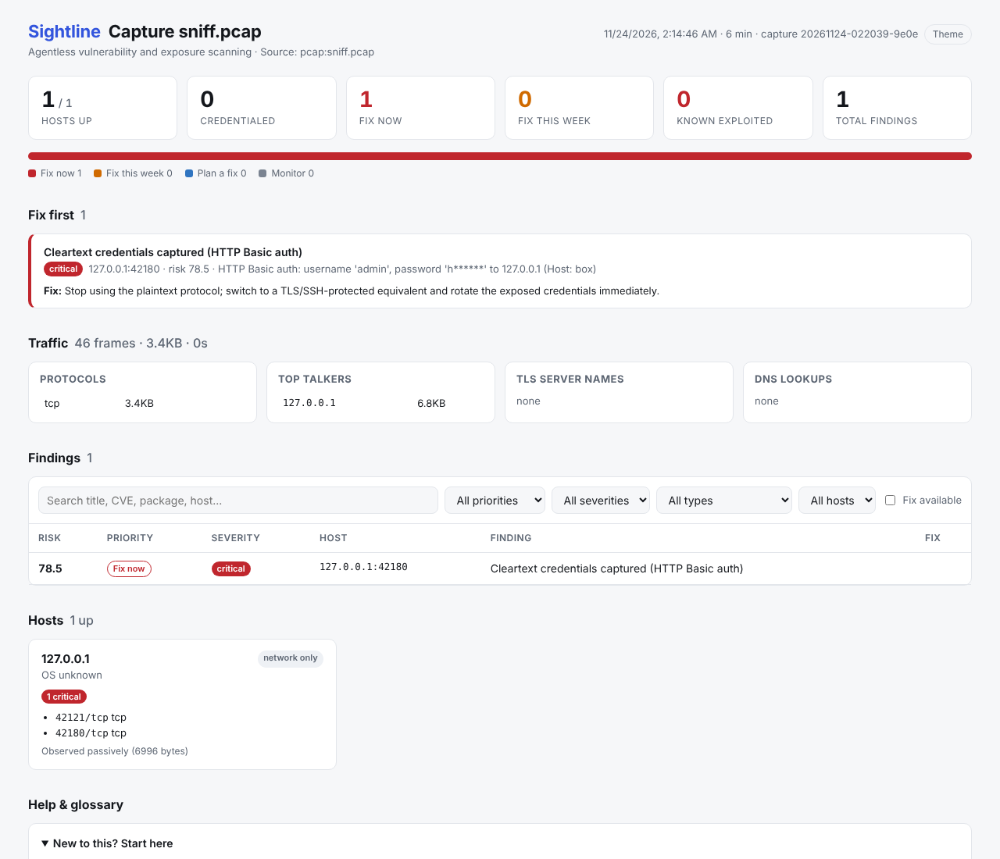

# Sightline

**One tool for finding what's wrong on your network: vulnerability scanning, live traffic
analysis, and exploit intelligence — for people who aren't full-time security pros.**

Sightline rolls together the jobs you'd normally need three or four tools for — a vulnerability
scanner, a packet analyzer (like Wireshark), and the "is this actually exploitable?" knowledge of a
framework like Metasploit — and then tells you the handful of things to fix first, in plain English.


## Why this exists

Commercial scanners such as Nessus are excellent and huge. For a small team they also cost thousands
a year, bury you in findings, and often flag things your Linux distribution already patched. Sightline
targets that gap, and adds two capabilities a plain scanner doesn't have:

| | Typical scanner | Sightline |
|---|---|---|
| Linux package vulnerabilities | Guessed from banners | Read from the package database over SSH, matched against the distro's own advisories (backported fixes handled correctly) |
| Prioritisation | CVSS severity | Risk score: severity + **is it exploited in the wild** (CISA KEV) + exploit likelihood (EPSS) + network exposure + fix availability |
| Exploit context | — | Each finding is labelled **exploited / exploit ready / PoC / none**, with links (Metasploit module, Exploit-DB) — *intelligence only, never weaponisation* |
| Traffic analysis | — | Built-in packet capture that flags **passwords sent in cleartext**, plaintext protocols, and a passive host inventory. Saves `.pcap` files Wireshark can open |
| "What do I do?" | One finding at a time | A **patch plan**: one command per machine that clears every fixable issue |
| For non-experts | Assumes expertise | Plain-language explanations and a glossary built into every report; `sightline explain <term>` |
| Make it yours | Fixed UI | Set your org name, accent colour, theme and defaults; reports and dashboard adopt them |
| Platforms | varies | Linux and Windows; macOS for analysis. Python only, **zero dependencies** |

## The three jobs it does

### 1. Vulnerability & exposure scanning
```bash
sightline scan 192.168.1.0/24                 # network scan of a subnet
sightline scan --local                        # credentialed scan of this machine
sightline scan web01 db01 --ssh-user ops --sudo --html report.html --fail-on fix-now
```
51 network/host checks (unauthenticated Redis/MongoDB/Elasticsearch/Docker/kubelet, SMBv1, RDP
without NLA, open VNC, anonymous FTP, exposed `.git`/`.env`, TLS problems, regreSSHion, and more),
plus package-vulnerability matching on Ubuntu, Debian, Alpine, Rocky and AlmaLinux (RHEL best effort),
and host-config audits (EOL OS, SSH policy, firewall, pending reboot, …).

### 2. Live traffic analysis (the Wireshark angle)
```bash
sudo sightline sniff --seconds 60                         # watch traffic, flag cleartext secrets
sudo sightline sniff --filter 'port 80,21,23' --write capture.pcap
sightline pcap capture.pcap                               # analyse a saved capture (no privileges)
```
Passively captures and decodes traffic (Ethernet/IP/TCP/UDP, DNS, DHCP, HTTP, TLS SNI, ARP) and turns
it into findings: **credentials sent in cleartext** (HTTP Basic, FTP, POP3/IMAP, SMTP AUTH),
passwords posted over plain HTTP, Telnet sessions, SNMP community strings, and plaintext protocols —
plus a passive inventory of who's talking to whom. Captures are written as standard `.pcap`, so they
open in Wireshark, tcpdump or tshark; conversely `sightline pcap` reads captures from those tools.



### 3. Exploit intelligence (the Metasploit angle — done safely)
Every finding is annotated with how weaponised it is:

- **exploited** — attackers are using it in the wild now (CISA KEV)
- **exploit ready** — a reliable public exploit exists (e.g. a named Metasploit module)
- **PoC** — a proof-of-concept exists, reliability varies
- *(blank)* — no public exploit known

with references so you can read more. This is the genuinely useful part of a framework like
Metasploit for a defender — knowing what to patch first — **without any exploitation**. Sightline never
launches exploits or payloads, never delivers shells, and never brute-forces credentials. Those are
what turn a scanner into an attack tool, and leaving them out is what lets you run this safely in an
authorised engagement.

## Make it yours

```bash
sightline config set --org-name "Acme Security" --accent teal --theme dark --analyst "Your Name"
sightline config set --default-ssh-user ops --default-sudo on   # stop repeating flags
sightline config show
```
Or open the dashboard (`sightline serve`) and click **Settings**. Your organisation name, accent
colour, theme and tagline flow into every HTML report and the dashboard, so it feels like your tool,
not a generic one.

## Built for people still learning security

- Every finding carries a plain-language description and a concrete fix.
- Every HTML report has a **Help & glossary** panel: how to read the report, what the priorities mean,
  and plain-English definitions of CVE, CVSS, KEV, EPSS, exposure, and more.
- `sightline explain KEV` (or `risk score`, `exposure`, `fix-now`, …) explains any term in the terminal.
- The dashboard has a **Help** button with the same guidance.

## All commands

```bash
sightline scan ...                   # vulnerability & exposure scan
sightline sniff ...                  # live packet capture + analysis (needs sudo/admin)
sightline pcap FILE                  # analyse a saved .pcap (anywhere, no privileges)
sightline serve                      # web dashboard: start scans, personalise, browse history
sightline history                    # past scans and captures
sightline show [ID]                  # re-print a result
sightline report ID --html r.html --json r.json --csv r.csv
sightline diff                       # what changed since the previous scan of the same targets
sightline checks                     # list the built-in scan checks
sightline explain [TERM]             # plain-language security glossary
sightline config show|set|reset      # personalisation and defaults
sightline db update ubuntu debian    # refresh advisories + KEV + EPSS
sightline db bundle ./feeds ubuntu   # download feeds for an air-gapped network...
sightline db import ./feeds          # ...and load them there
```

## Platforms

| | Linux | Windows | macOS |
|---|---|---|---|
| `scan` (network + SSH) | yes | yes | yes |
| `scan --local` (credentialed self-scan) | yes | — (Linux/mac packages) | yes |
| `sniff` (live capture) | yes (AF_PACKET, needs `sudo`) | yes (raw socket + SIO_RCVALL, needs Administrator) | capture with Wireshark, then `pcap` |
| `pcap`, reports, dashboard, config | yes | yes | yes |

On Windows, run live capture from an **Administrator** terminal. On Linux you can avoid `sudo` for
capture with: `sudo setcap cap_net_raw,cap_net_admin+eip $(readlink -f $(which python3))`.

## How scanning works

```
targets ─▶ TCP connect scan ─▶ service fingerprinting ─▶ network checks ─┐
        └▶ one SSH session runs a POSIX collection script ─▶ inventory ──┤
              (OS, packages, sshd config, listening sockets, …)          │
                  ─▶ package matching vs local OSV/KEV/EPSS DB ──────────┤
                  ─▶ host configuration checks ───────────────────────────┤
                                                                         ▼
          exploit intelligence ─▶ risk scoring ─▶ fix-now / fix-this-week / plan / monitor
          ─▶ diff vs previous scan ─▶ terminal / HTML / JSON / CSV / dashboard
```

Discovery uses plain TCP `connect()` (no root, no raw sockets). Credentialed collection runs the
system `ssh` client in one session (honours `~/.ssh/config`, agents, jump hosts). Package matching uses
the distro's own advisory stream for the exact release, with native dpkg/rpm/apk version comparison.
Data lives in `~/.sightline` (override with `SIGHTLINE_HOME`).

## Web dashboard security

The dashboard can launch scans, so it's locked down: binds to `127.0.0.1` by default; requires a
random token on any other interface; rejects cross-site requests (a custom header is required on every
state-changing call); and validates the `Host` header against DNS-rebinding.

## Limitations and roadmap

Deliberately narrow for now. Not yet covered: Windows **patch** auditing (WMI/WinRM), network-device
firmware, authenticated web-app scanning, full CIS compliance profiles, CVSS v4 scoring, and live
capture decode of encrypted payloads (by design — it flags *that* traffic is unencrypted, it doesn't
break encryption). RHEL advisory matching is best effort.

## Legal

Only scan or capture on systems and networks you own or have written permission to test.
Unauthorised scanning or traffic interception may be illegal in your jurisdiction.

## Development

```bash
python -m pytest -q      # 161 tests, fully offline
```
The suite uses fake Redis/MongoDB/VNC/RDP/SMB/FTP/HTTP/TLS servers, crafted packets and fixture
inventories; it needs no network and no root.
