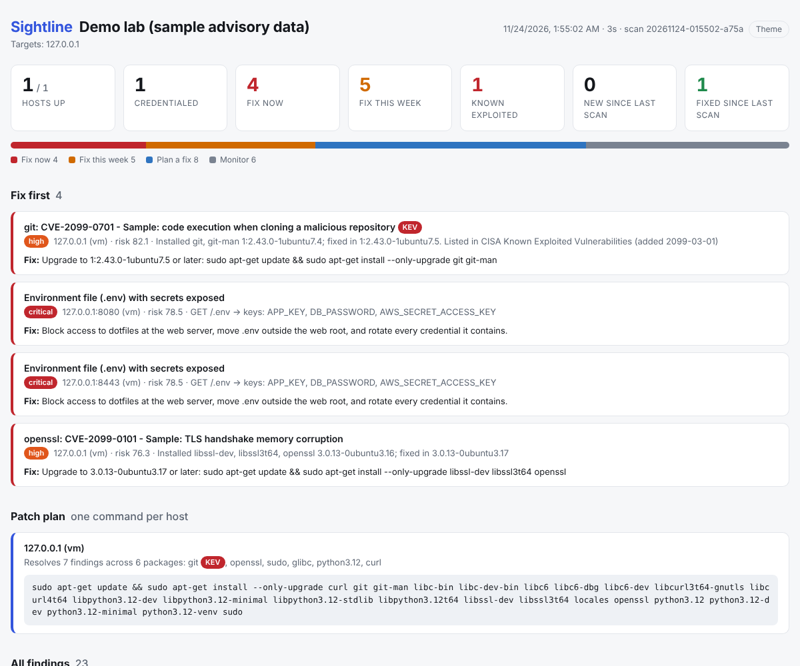

# Sightline

**Agentless vulnerability and exposure scanning for small teams running Linux.**
Sightline tells you the handful of things to fix first, instead of handing you a 400-page report.



## Why another scanner?

Commercial scanners such as Nessus are excellent and enormous. For a small team with a few dozen
Linux servers, they also cost thousands a year, produce long reports full of noise, and often flag
vulnerabilities that the distro has already patched. Sightline targets that gap:

| | Typical network scanner | Sightline |
|---|---|---|
| Linux package vulnerabilities | Often guessed from service banners | Read from the package database over SSH and matched against the distro's own advisories, so backported fixes are handled correctly |
| Prioritisation | CVSS severity | Risk score combining severity, CISA KEV (known exploited), EPSS (exploit likelihood), network exposure and fix availability |
| "What do I do?" | One finding at a time | A **patch plan**: one upgrade command per host that clears every fixable finding |
| Progress over time | Separate reports | Every scan is diffed against the last: **new** and **fixed since last scan** |
| Install | Agents, licences, daemons | Python 3.10+, **zero dependencies**, uses your existing `ssh` setup |
| Data privacy | Inventory often sent to a cloud | Fully local. Advisory data is downloaded once, and scans work offline or air-gapped |

## What it checks

- **Vulnerable packages** on Ubuntu, Debian (and derivatives like Mint/Raspberry Pi OS), Alpine,
  Rocky Linux and AlmaLinux, with RHEL as best effort. Matching uses OSV.dev distro advisory data and native
  `dpkg`, `rpm` and `apk` version comparison. The dpkg logic is verified against the real `dpkg`, and the rpm logic
  against rpm's own test vectors.
- **Network exposures** (51 built-in checks, run `sightline checks`): unauthenticated Redis, MongoDB,
  Elasticsearch, memcached, Docker API, kubelet, etcd, VNC; SMBv1; RDP without NLA; anonymous and
  cleartext FTP; telnet; SNMP `public`; exposed `.git` / `.env` / phpinfo / server-status /
  Spring actuator / Jenkins script console; TLS expiry, self-signed, weak keys, SHA-1 signatures,
  TLS 1.0/1.1, hostname mismatch; banner checks such as regreSSHion (CVE-2024-6387) that account
  for Ubuntu/Debian backports. Databases, RDP and SMB exposed on public IPs are flagged.
- **Host configuration** (credentialed): end-of-life OS, pending reboot after security updates,
  SSH root/password/empty-password logins, extra UID 0 accounts, empty passwords, readable
  `/etc/shadow`, passwordless sudo, no automatic updates, no firewall, ASLR disabled, data stores
  listening on all interfaces.

Every network probe is read-only: handshakes, version queries and harmless reads. Sightline never
attempts exploitation.

## Quick start

```bash
cd sightline
pip install .            # or run in place: python -m sightline ...

# Network scan of a subnet
sightline scan 192.168.1.0/24

# Credentialed scan of this machine (downloads advisory data on first run)
sightline scan --local

# Credentialed scan of servers over SSH, with HTML report, failing CI on anything urgent
sightline scan web01 db01 10.0.0.20-40 --ssh-user ops --ssh-key ~/.ssh/id_ed25519 --sudo \
    --html report.html --fail-on fix-now

# Web dashboard (start scans, watch progress, browse history)
sightline serve          # http://127.0.0.1:8077
```

Other commands:

```bash
sightline history                    # past scans
sightline show [SCAN_ID]             # re-print a scan in the terminal
sightline report latest --html r.html --json r.json --csv r.csv
sightline diff                       # what changed since the previous scan of the same targets
sightline checks                     # list every check
sightline db update ubuntu debian    # refresh advisories + KEV + EPSS
sightline db status
sightline db bundle ./feeds ubuntu   # download feeds for an air-gapped network...
sightline db import ./feeds          # ...and load them there
```

## How it works

```
targets -> TCP connect scan -> service fingerprinting -> network checks ─┐
        └> one SSH session runs a POSIX collection script -> inventory ─┤
              (OS, packages, sshd config, listening sockets, ...)        │
                  -> package matching against local OSV/KEV/EPSS DB ─────┤
                  -> host configuration checks ──────────────────────────┤
                                                                         v
                    risk scoring -> fix-now / fix-this-week / plan / monitor
                    -> diff vs previous scan -> terminal / HTML / JSON / CSV / dashboard
```

- **Discovery** uses plain TCP `connect()`, so it needs no root and no raw sockets. A refused connection
  still proves a host is up, so hosts that block ping are found.
- **Credentialed collection** runs your system `ssh` with `BatchMode`. It honours `~/.ssh/config`,
  agents, jump hosts and certificates. The whole inventory comes back from one session in well under a
  second. `--sudo` uses `sudo -n` and falls back gracefully if a password would be needed.
- **Package matching** uses the distro's own advisory stream for the exact release (for example
  `Ubuntu:22.04:LTS`). Binary packages are grouped by source package. Overlapping advisories (a
  USN and its per-CVE records) are merged into one finding per CVE. Ubuntu Pro/ESM-only fixes are labelled.
- **Risk score (0-100)** = severity (distro triage blended with CVSS) + network exposure
  (the package's daemon listens on a non-loopback socket, or the issue is a network finding)
  + exploitation (KEV, EPSS). It is reduced when no fix exists yet or detection is banner-based.
  When credentialed data exists for a host, banner guesses for that host are dropped in favour of the
  package evidence.

Data lives in `~/.sightline` (override with `SIGHTLINE_HOME`): `vulndb.sqlite` and `scans.sqlite`.

## Web dashboard security

The dashboard can launch scans, so it is locked down. It binds to `127.0.0.1` by default. It requires a random
access token whenever it listens on another interface. It rejects cross-site requests (a custom
header is required on every state-changing call). It also validates the `Host` header to stop DNS-rebinding
attacks.

## Limitations and roadmap

Sightline is an early-stage tool and deliberately narrow. Not yet covered:

- Windows patch auditing (WMI/WinRM), network device firmware (Cisco, Fortinet, ...)
- Authenticated web-application scanning (use a DAST tool like ZAP)
- CIS benchmark compliance profiles (the config checks are a pragmatic subset)
- CVSS v4 scoring (v4-only records fall back to the distro severity)
- RHEL advisory matching is best effort; CentOS/Oracle/Amazon Linux get config checks only
- UDP scanning beyond the SNMP probe; language-ecosystem packages (pip/npm) on hosts

## Legal

Only scan systems you own or have written permission to test. Unauthorised scanning may break
computer misuse laws in your jurisdiction.

## Development

```bash
pip install pytest
python -m pytest -q
```

The test suite runs entirely offline. It uses fake Redis, MongoDB, VNC, RDP, SMB, FTP, HTTP and TLS servers to
check detection logic, plus fixture inventories for Ubuntu, Rocky and Alpine.
